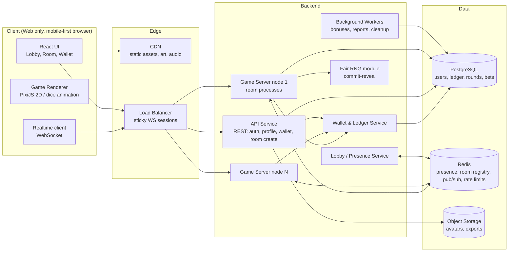
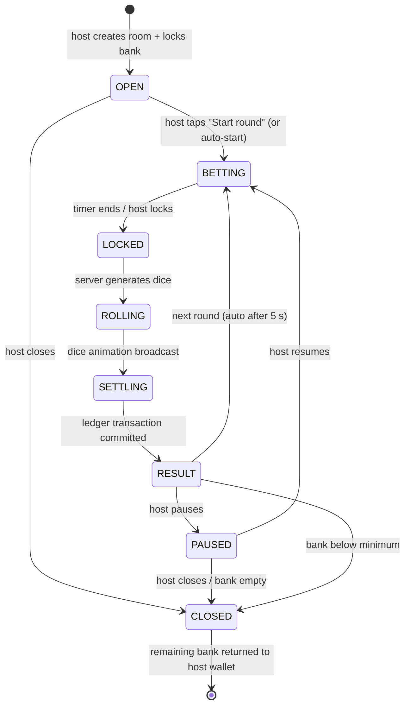
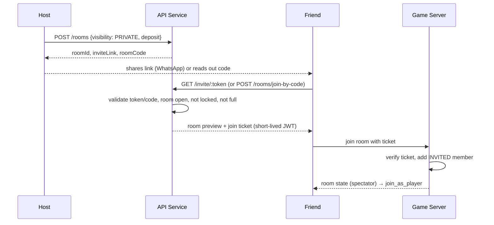
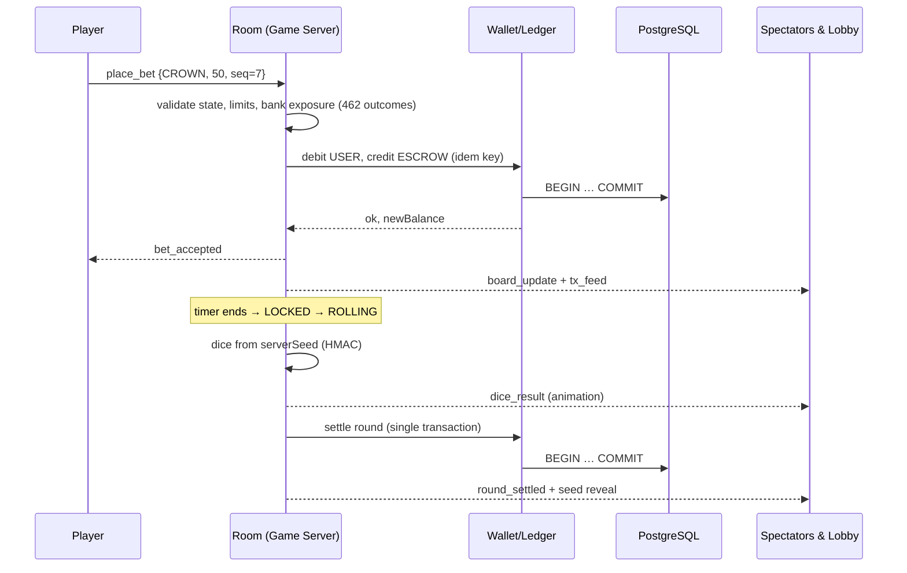

# Jhandi Burja (झण्डी बुर्जा) — System Architecture

> Status: **v1.0 — final for review.** No game code is written until this document is finalized. Decisions taken so far are in §13.
> Scope: a real-time, multi-room, multiplayer Jhandi Burja game for Dashain, themed with authentic Nepali heritage art.

---

## 1. Product Summary

Jhandi Burja is the most popular Dashain dice game in Nepal. Six dice, each with six faces (Crown, Flag, Heart, Spade, Diamond, Club), are shaken together. Players put coins on symbols; the more times a symbol shows up, the more the player wins.

This game brings that experience online:

- **Many rooms run at the same time.** Any user who deposits the minimum host bank (§2.4) can become a **Host** (खेलाउने मान्छे / dealer) and open a room. Several hosts can run their own tables in parallel.
- **Public and private rooms.** Public rooms are listed in the lobby. Private rooms (for family and friends) are hidden and can only be joined with the invite link or the room code (§5.6).
- **A lobby shows every live room**: who is hosting, how many players and spectators are in it, the current round state, recent results, and the live coin flow (transactions).
- **New users can watch first, then join.** They open a room as a spectator, see what is happening, then join as a player and place coins on symbols.
- **The Host rolls and the server settles.** Winners are paid from the Host's bank, losers' coins go to the Host's bank.
- **The look and feel is authentically Nepali**: temples, Newari wood carving, Dhaka patterns, and Dashain elements (tika, jamara, kites, ping).

### 1.1 Roles

| Role                  | Who                                                                         | What they can do                                                                                                                               |
| --------------------- | --------------------------------------------------------------------------- | ---------------------------------------------------------------------------------------------------------------------------------------------- |
| **Guest / Spectator** | Anyone on the lobby or inside a room without joining                        | View rooms, view the live bet board, results, and the transaction feed                                                                         |
| **Player**            | A logged-in user who joined a room                                          | Place / cancel bets during the betting window, receive payouts                                                                                 |
| **Host (Banker)**     | A logged-in user who created a room and deposited at least the minimum bank | Configure the room, start rounds, trigger the roll, pause / close the room; for private rooms also share / reset the invite and remove members |
| **System Host**       | A server-run bot host                                                       | Keeps "always-on" public rooms running when no human host is available                                                                         |
| **Admin**             | Operator staff                                                              | Moderation, coin grants, freezes, audit, live-ops events                                                                                       |

---

## 2. Game Rules (Server-Authoritative)

### 2.1 Symbols

| Code      | Traditional | Nepali name    | Heritage art direction (see §9)     |
| --------- | ----------- | -------------- | ----------------------------------- |
| `CROWN`   | Crown       | बुर्जा / मुकुट | Shirpech-style plumed crown         |
| `FLAG`    | Flag        | झण्डा          | Nepal's double-pennant flag         |
| `HEART`   | Heart       | पान            | Heart framed in Newari wood-carving |
| `SPADE`   | Spade       | सुरत           | Spade with pagoda-roof silhouette   |
| `DIAMOND` | Diamond     | ईंट्टा         | Diamond with Dhaka-cloth pattern    |
| `CLUB`    | Club        | चिडी           | Club in lotus/Paubha style          |

The six internal codes never change; only the artwork is themed. This keeps game logic independent from art.

### 2.2 Round flow

1. Betting window opens (default 20 s).
2. Players place coins on one or more symbols.
3. Betting locks.
4. Six dice are rolled **on the server**.
5. For each bet, count `k` = how many of the six dice show that symbol.
6. Settle using the room's payout table.

### 2.3 Payout table (decided: default table, virtual coins)

| Matches `k` | Result for a bet of `b`              |
| ----------- | ------------------------------------ |
| 0 or 1      | Player loses `b` (goes to Host bank) |
| 2           | Player gets `b` back **+ 2 × b**     |
| 3           | `b` back + 3 × b                     |
| 4           | `b` back + 4 × b                     |
| 5           | `b` back + 5 × b                     |
| 6           | `b` back + 6 × b                     |

Probability math (one symbol, six fair dice, `P(face) = 1/6`):

| k    | 0      | 1      | 2      | 3     | 4     | 5      | 6      |
| ---- | ------ | ------ | ------ | ----- | ----- | ------ | ------ |
| P(k) | 33.49% | 40.19% | 20.09% | 5.36% | 0.80% | 0.064% | 0.002% |

Player expected value with the default table ≈ **−13.9 % per bet** (i.e. the Host's edge). All stakes and payouts are in **virtual coins**. v1 uses this one table for every room; the payout table is still stored in room config so other regional variants can be added later. If custom tables are allowed later, the server must validate them so the Host edge stays within an allowed band (e.g. 3 %–20 %).

### 2.4 Host deposit, bank & exposure (solvency rule)

To host, a user must **deposit a minimum amount of virtual coins** into the room's **bank** (`MIN_HOST_DEPOSIT`, default **5,000 coins**, configurable by admin). The room cannot open until the deposit is locked. The host can top up the bank between rounds. If the bank falls below `MIN_HOST_BANK_TO_CONTINUE` (default 1,000 coins) after a round, the room pauses until the host tops up, or closes.

The server must guarantee the Host can always pay.

- Before accepting any bet, the server computes the **worst-case payout** across all possible outcomes.
- The outcome of six dice is a count vector over six symbols that sums to 6 — only **462 combinations**, so exact enumeration on every bet is cheap.
- `worstCaseLiability = max over outcomes( Σ payouts − Σ losing stakes )`
- A bet is rejected (`BANK_LIMIT_REACHED`) if `worstCaseLiability > hostBank`.
- Additional per-room limits: min bet, max bet per symbol, max bet per player per round.

### 2.5 Platform fee (virtual coins)

The platform takes a small fee, also in **virtual coins**:

- Charged on the **Host's net profit per round** only (`max(0, losing stakes − winnings paid)`); nothing is charged when the host loses or breaks even, and players never pay a fee.
- Default `PLATFORM_FEE_BPS = 200` (basis points, = 2 %), rounded down to whole coins, configurable by admin. Stored as an integer so coin math never uses floats.
- Moved from `ROOM_BANK:room` to `SYSTEM:PLATFORM_FEE` inside the same settlement transaction (§5.4).
- The fee works as a coin sink that keeps the virtual economy from inflating; fee coins fund daily bonuses and Dashain events.

### 2.6 Coin economy (decided)

| Setting                     | Value           | Notes                                                  |
| --------------------------- | --------------- | ------------------------------------------------------ |
| `SIGNUP_BONUS`              | **5,500 coins** | Credited once, on the user's first successful sign-in  |
| `DAILY_BONUS`               | **10 coins**    | Claimable once per calendar day (Nepal time, UTC+5:45) |
| `MIN_HOST_DEPOSIT`          | **5,000 coins** | Required to open any room (§2.4)                       |
| `MIN_HOST_BANK_TO_CONTINUE` | 1,000 coins     | Below this the room pauses (§2.4)                      |
| `PLATFORM_FEE_BPS`          | **200 (= 2 %)** | Of the host's net profit per round (§2.5)              |
| `PRIVATE_ROOM_MAX_MEMBERS`  | **20**          | §5.6                                                   |

All values live in `platform_settings` and can be changed by an admin without a deploy.

**First-time user journey:**

1. User signs in for the first time (phone OTP or Google).
2. Server creates the user and their `USER:{userId}` account, then credits **5,500 coins** from `SYSTEM:BONUS` with idempotency key `signup:{userId}`, so the bonus can never be paid twice even if sign-up is retried.
3. A short welcome screen shows the 5,500 coins and explains the two options:
   - **Play:** join any public room (or a private room by link/code) and bet.
   - **Host:** open a room right away by depositing 5,000 coins, keeping 500 coins in hand.
4. From the next day, the user can claim 10 coins daily.

Note: because the daily bonus is small, a user who loses all coins recovers slowly. This is intentional (coins keep their value), and Dashain events (§5.7) can give extra coins when needed.

---

## 3. High-Level Architecture



### 3.1 Key principles

1. **Server-authoritative.** The client only sends _intent_ (e.g. "bet 50 on CROWN"). Dice, validation, balances and payouts are decided only on the server.
2. **One room = one in-memory process (actor).** Each room's state lives in a single game-server process, so there are no race conditions inside a room. Rooms are spread across nodes.
3. **Money is never in memory only.** Every coin movement is written to the ledger (PostgreSQL) in an ACID transaction before it is shown as final to users.
4. **Realtime fan-out via state sync.** Clients get state patches over WebSocket; the lobby gets lightweight summaries via Redis pub/sub.
5. **Provably fair.** Every round publishes a hash of the server seed _before_ betting and reveals the seed _after_, so anyone can verify the roll.

---

## 4. Technology Choices

| Layer              | Choice                                                                                                                            | Why                                                                                               |
| ------------------ | --------------------------------------------------------------------------------------------------------------------------------- | ------------------------------------------------------------------------------------------------- |
| Language           | **TypeScript** everywhere                                                                                                         | Shared types for game rules and messages between client and server                                |
| Client framework   | **React + Vite** (web only for v1; no native apps)                                                                                | Fast, works in any phone or desktop browser; can be made installable (PWA) later at no extra cost |
| UI styling / state | **Tailwind CSS**; **Zustand** for live room state, **TanStack Query** (via tRPC) for API data                                     | Fast UI work; realtime room state changes many times per second                                   |
| Game rendering     | **Inline SVG + CSS animation** (PixiJS dropped in M6: six dice and a 3×2 board run at 60 fps without WebGL, and it saves ~300 kB) | Smooth on low-end Android phones, common in Nepal                                                 |
| Realtime server    | **Colyseus** (Node.js)                                                                                                            | Built-in rooms, matchmaking, state sync, reconnection, Redis scaling                              |
| API                | **Express + tRPC**, all input validated with **Zod**                                                                              | End-to-end typed calls between web and API; Zod checks every input at the boundary                |
| Database           | **PostgreSQL on Supabase** (managed cloud; session pooler; tables in the `jhandi` schema)                                         | ACID transactions for the coin ledger; no database server to run ourselves                        |
| Cache / presence   | **Redis** (managed, e.g. Upstash — added in M4; optional before that)                                                             | Room registry, presence, lobby pub/sub, rate limiting, Colyseus driver                            |
| ORM / migrations   | **Drizzle ORM + drizzle-kit**                                                                                                     | Typed schema, SQL-close queries (needed for `FOR UPDATE` ledger locks), plain SQL migrations      |
| Auth               | Phone OTP + Google sign-in, JWT access + refresh tokens                                                                           | Phone numbers are the common identity in Nepal                                                    |
| Infra              | Managed services only: Supabase Postgres, managed Redis, app hosting in a Mumbai/Singapore region. No Docker in local development | Low latency to Nepal, nothing to operate locally                                                  |
| Observability      | OpenTelemetry, Prometheus + Grafana, Sentry                                                                                       | Metrics, tracing, crash reports                                                                   |

---

## 5. Core Services

### 5.1 API Service (tRPC over Express)

The routes below describe each operation; they are implemented as tRPC procedures (exact names in [api-protocol.md](api-protocol.md)). The invite link `/r/:inviteToken` is a web page that calls the `invite.preview` procedure.

- `POST /auth/otp/request`, `POST /auth/otp/verify`, `POST /auth/google`, `POST /auth/refresh`
- `GET /me`, `PATCH /me` (display name, avatar)
- `GET /wallet` (balance), `GET /wallet/transactions?cursor=`
- `POST /wallet/daily-bonus` (10 coins, once per day; sign-up bonus is credited automatically on first sign-in, no endpoint)
- `POST /rooms` (create room: name, bank deposit ≥ `MIN_HOST_DEPOSIT`, limits, `visibility: PUBLIC | PRIVATE`) → returns `roomId` (+ `inviteLink`, `roomCode` for private rooms)
- `GET /rooms` (initial lobby snapshot of **public** rooms only; live updates come over WebSocket)
- `GET /invite/:inviteToken` → resolves an invite link to a room preview (name, host, players)
- `POST /rooms/join-by-code` `{ roomCode }` → resolves a typed room code to a room
- `POST /rooms/:id/invite/reset` (host only) → new link + code; old ones stop working
- `GET /rounds/:id/verify` (seed, hash, dice — fairness proof)

### 5.2 Game Server (Colyseus rooms)

Each `JhandiRoom` instance owns:

- Room config (host, limits, payout table, betting-window length)
- Members: host, players, spectators
- Current round: state, server seed hash, bets board, timers
- Last N results and a rolling transaction feed

Room state machine:



Rules:

- The host cannot close or withdraw the bank while a round is in `BETTING`, `LOCKED`, `ROLLING` or `SETTLING`.
- If the host disconnects, the room keeps running on auto-start for a grace period (e.g. 2 minutes), then pauses. If the host doesn't return, the room closes safely after the current round settles.

### 5.3 Lobby / Presence Service

- Every **public** room publishes a **room summary** as Colyseus room metadata on each change (throttled to ~1/s). Colyseus' presence layer (in-process on one node, Redis across nodes) fans it out to the lobby room, which streams it to lobby clients. Private rooms are never published to the lobby or the global ticker; their summary is visible only to people who already have access.
  `{ roomId, name, host: {id, name, avatar}, players, spectators, state, roundNo, bankBalance, minBet, maxBet, lastResults[], volumeLast10Min, createdAt }`
- Lobby clients join the `lobby` room and receive the full list, then diffs (`+` / `-`).
- Lobby UI: list/grid of live rooms with sorting (most players, highest volume, newest) and filters (bet range).
- A global **live ticker** shows recent big wins across all rooms ("Ram won 1,200 coins on CROWN ×4 in Room Patan").

### 5.4 Wallet & Ledger Service

The most important part for correctness. Uses **double-entry bookkeeping**: every movement is a debit on one account and an equal credit on another, so the total is always balanced.

Account types:

- `USER:{userId}` — a user's spendable coins
- `ROOM_BANK:{roomId}` — the coins the host has locked as bank
- `ROUND_ESCROW:{roundId}` — bets held while a round is in progress
- `SYSTEM:BONUS`, `SYSTEM:PLATFORM_FEE` (§2.5), `SYSTEM:ADJUSTMENT`

Flows:

| Event                                         | Debit                | Credit                |
| --------------------------------------------- | -------------------- | --------------------- |
| Host opens room (deposit ≥ minimum) / tops up | `USER:host`          | `ROOM_BANK:room`      |
| Player places bet                             | `USER:player`        | `ROUND_ESCROW:round`  |
| Player cancels bet (betting window only)      | `ROUND_ESCROW:round` | `USER:player`         |
| Losing bet settles                            | `ROUND_ESCROW:round` | `ROOM_BANK:room`      |
| Winning bet settles (stake back)              | `ROUND_ESCROW:round` | `USER:player`         |
| Winning bet settles (winnings)                | `ROOM_BANK:room`     | `USER:player`         |
| Platform fee on host's round profit           | `ROOM_BANK:room`     | `SYSTEM:PLATFORM_FEE` |
| Room closes                                   | `ROOM_BANK:room`     | `USER:host`           |
| Sign-up bonus (5,500, once)                   | `SYSTEM:BONUS`       | `USER:user`           |
| Daily bonus (10, once per day)                | `SYSTEM:BONUS`       | `USER:user`           |

Guarantees:

- Every write carries an **idempotency key** (e.g. `bet:{roundId}:{userId}:{clientSeq}`, `settle:{roundId}`) so retries never double-pay.
- A whole round's settlement is **one database transaction**.
- Balances are updated with row-level locks (`SELECT … FOR UPDATE`) or a `CHECK (balance >= 0)` constraint; balances can never go negative.
- A nightly job checks that the sum of all accounts equals the total coins ever minted.

### 5.5 Fair RNG (commit–reveal)

1. At round start the server creates a random `serverSeed` (crypto-secure, 32 bytes) and broadcasts `seedHash = SHA-256(serverSeed)`.
2. When betting locks: `dice[i] = HMAC-SHA256(serverSeed, roundId + ":" + i)` → mapped to 0–5 with rejection sampling (no modulo bias).
3. After the result, `serverSeed` is revealed. Anyone can recompute the hash and the dice via `GET /rounds/:id/verify` or an in-app "Verify" button.
4. Optional: mix in a public value (e.g. the hash of all bets) to show the host could not pick the seed after seeing bets.

### 5.6 Private Rooms (family & friends)

A private room works exactly like a public one (same rules, host deposit, bank, fee), but **only people with the invite can see or join it**.

**Creating:** the host picks _Private_ when creating the room. The server generates:

- an **invite link** — `https://<domain>/r/<inviteToken>` where `inviteToken` is a 128-bit random, URL-safe token;
- a **room code** — 6 characters from an unambiguous alphabet (no `0/O`, `1/I/L`), e.g. `K7TQ2M`, easy to read out over the phone.

The host gets a share sheet with: _Copy link_, _Share_ (browser Web Share API → WhatsApp, Viber, Messenger, etc.), and the code shown in large letters.

**Joining:**

- **By link:** opening the link shows a room preview (room name, host, number of players). Not logged in → log in first, then return to the same link automatically.
- **By code:** the lobby has a _Join with code_ button; entering the code opens the same preview.
- After confirming, the user enters as a spectator and can then _Join as player_, same as a public room.
- The server records the user in `room_members` with `access = INVITED`; after that they can re-enter the room without the code until removed. (Implemented without a separate join ticket: the game server reads this row on join.)

**Host controls:**

- **Reset invite:** creates a new link + code; the old ones stop working immediately (people already inside stay).
- **Lock room:** temporarily stop any new joins, even with a valid code.
- **Remove member:** removes a user from the room and revokes their access (their in-progress bet for the current round is refunded).
- **Max members** (default 20) to keep family rooms small.

**Security:**

- Private rooms never appear in `GET /rooms`, the lobby channel, or the global ticker.
- The game server refuses a WebSocket join to a private room unless the user is the host or has an `INVITED` membership.
- Code entry is rate-limited (e.g. 5 wrong attempts per user per 10 minutes, plus per-IP limits) so codes cannot be guessed by brute force.
- Codes and tokens are stored hashed (HMAC with the server secret); only active rooms' codes are valid, and they expire when the room closes. The host sees the plain link/code once (create or reset); the web keeps them in that browser's storage, and the host can reset to get new ones from any device.



### 5.7 Background Workers

- Daily Dashain bonus reset, streak rewards (Ghatasthapana → Kojagrat Purnima event calendar)
- Abandoned-room cleanup and bank refunds
- Ledger reconciliation and alerts
- Leaderboards (daily / Dashain season)

---

## 6. Real-time Protocol

Transport: WebSocket (Colyseus). State is synced automatically as binary patches; the explicit messages are below.

### 6.1 Client → Server

| Message                               | Payload                         | Allowed when                                              |
| ------------------------------------- | ------------------------------- | --------------------------------------------------------- |
| `join_as_player`                      | `{}`                            | Spectator inside room                                     |
| `place_bet`                           | `{ symbol, amount, clientSeq }` | `BETTING`                                                 |
| `cancel_bet`                          | `{ symbol }`                    | `BETTING`                                                 |
| `host_start_round`                    | `{}`                            | Host, `OPEN`/`RESULT`/`PAUSED`                            |
| `host_lock_and_roll`                  | `{}`                            | Host, `BETTING`                                           |
| `host_pause` / `host_close`           | `{}`                            | Host                                                      |
| `host_lock_room` / `host_unlock_room` | `{}`                            | Host, private room                                        |
| `host_remove_member`                  | `{ userId }`                    | Host, private room                                        |
| `host_top_up_bank`                    | `{ amount }`                    | Host, not mid-settlement                                  |
| `chat` / `reaction`                   | `{ text }` / `{ emoji }`        | Rate-limited (text chat + reactions only; no voice in v1) |

### 6.2 Server → Client

| Message                         | Payload                                                                                            |
| ------------------------------- | -------------------------------------------------------------------------------------------------- |
| `round_started`                 | `{ roundId, roundNo, seedHash, bettingEndsAt }`                                                    |
| `bet_accepted` / `bet_rejected` | `{ symbol, amount, newBalance }` / `{ reason }`                                                    |
| `board_update` (state sync)     | totals per symbol, number of bettors per symbol                                                    |
| `round_locked`                  | `{ roundId }`                                                                                      |
| `dice_result`                   | `{ roundId, dice: [6 symbols], counts }`                                                           |
| `round_settled`                 | `{ roundId, yourPayout, winners: [{user, symbol, amount}], platformFee, bankBalance, serverSeed }` |
| `member_removed`                | `{ userId }` (private room)                                                                        |
| `tx_feed`                       | `{ type: BET                                                                                       | WIN | LOSS | BANK_TOPUP, user, symbol, amount, at }` |
| `room_closed`                   | `{ reason }`                                                                                       |

Reject reasons: `NOT_BETTING`, `INSUFFICIENT_BALANCE`, `BELOW_MIN`, `ABOVE_MAX`, `BANK_LIMIT_REACHED`, `RATE_LIMITED`, `NOT_INVITED`, `ROOM_LOCKED`, `ROOM_FULL`, `INVALID_CODE`.

### 6.3 Bet sequence



---

## 7. Data Model (PostgreSQL)

```
users(id, phone, google_id, display_name, avatar_url, status, created_at)
accounts(id, type, owner_id, balance BIGINT CHECK (balance >= 0), updated_at)
ledger_entries(id, tx_id, account_id, amount BIGINT, direction, created_at)
transactions(id, kind, idempotency_key UNIQUE, ref_type, ref_id, created_at)

rooms(id, host_id, name, visibility, config JSONB, status, bank_account_id,
      is_locked, max_members, created_at, closed_at)
room_invites(id, room_id, token_hash, code_hash, created_by, created_at,
             revoked_at)                      -- one active row per private room
room_members(room_id, user_id, role, access, joined_at, left_at, removed_at)
platform_settings(key, value JSONB, updated_by, updated_at)
                  -- MIN_HOST_DEPOSIT, MIN_HOST_BANK_TO_CONTINUE, PLATFORM_FEE_BPS
rounds(..., platform_fee BIGINT)              -- fee taken this round

rounds(id, room_id, round_no, status, seed_hash, server_seed, dice SMALLINT[6],
       started_at, locked_at, settled_at)
bets(id, round_id, user_id, symbol, amount, status, payout, created_at)

bonuses(id, user_id, kind, amount, claimed_at)
audit_log(id, actor_id, action, target, data JSONB, created_at)
```

- Coins are stored as integers (`BIGINT`), never floats.
- `rounds.server_seed` is written only after settlement.
- Indexes: `bets(round_id)`, `bets(user_id, created_at)`, `ledger_entries(account_id, created_at)`, `rooms(status)`.

---

## 8. Scaling & Reliability

- **Horizontal game servers.** Colyseus with Redis presence + driver; the load balancer uses sticky sessions so a client stays on the node that hosts its room. A room is pinned to one node.
- **Capacity target (v1):** 2,000 concurrent users, 200 live rooms, ≤ 150 ms bet-ack latency from Nepal.
- **Reconnection.** Clients reconnect with a session token within 30 s and receive full room state; their bets stay valid.
- **Node crash.** Because escrow is in the ledger, a crashed room's in-flight round is either (a) re-settled by a recovery worker if dice were already generated and stored, or (b) voided with all escrow refunded. Never lost.
- **Backpressure.** Lobby updates throttled; tx feed batched every 250 ms in busy rooms.
- **Rate limits** per user and per IP on bets, chat and room creation.

---

## 9. Heritage Theme & Art Direction

Goal: it should feel like playing Jhandi Burja on a _khal_ (cloth board) in a Newari courtyard during Dashain.

- **Board (khal):** Dhaka-pattern fabric with brass corner pieces; six large symbol tiles with carved wooden frames (Newari _tunal_ / window lattice style).
- **Dice:** carved wooden blocks with brass inlay symbols; shaken in a traditional bowl / _dhakani_ lid, revealed with a lift animation.
- **Backgrounds (switchable "venues" for rooms):** Bhaktapur Nyatapola, Patan Krishna Mandir, Basantapur Durbar Square, Changu Narayan, Swayambhu, Gorkha Durbar — each as an original illustration.
- **Dashain elements:** jamara, red tika, kites (changa) in the sky, bamboo _ping_ (swing), malshree dhun background music, festive marigold garlands.
- **UI chrome:** Ranjana/Devanagari-inspired headings, terracotta / brick red / brass / deep green palette.
- **Localization:** Nepali (default) and English; Devanagari numerals optional.
- **Cultural sensitivity:** no deity images on dice, bet tiles, or anything coins are placed on; temples are used as scenery only. All art must be original (commissioned or in-house), not copied photos.
- **Performance:** sprite atlases, WebP/AVIF, total initial download under ~3 MB for 3G/4G users.

---

## 10. Security, Fairness & Compliance

- **Virtual coins only (v1, decided).** Bets, payouts, host deposits and the platform fee all use virtual coins. Coins are free (sign-up and daily bonuses) and **cannot be bought with or cashed out for real money**. Real-money gambling is restricted in Nepal; any move toward purchases, cash-out or tradable tokens requires legal review first and is out of scope here.
- Server-authoritative logic; clients never decide outcomes or balances.
- JWT validation on WebSocket join; room membership checked on every message.
- Anti-abuse: one account per phone, device fingerprint signals for bonus farming, collusion detection (host + players funneling coins between accounts), report/ban tools.
- Age gate (18+ confirmed at sign-up, stored as `users.age_confirmed_at`) and responsible-play limits: `DAILY_LOSS_CAP` (default 3,000 coins per Kathmandu day, enforced by the game server before every bet) and an hourly session reminder in the web app.
- All admin actions recorded in `audit_log`.

---

## 11. Proposed Repository Structure (monorepo)

```
dashain-game/
├─ docs/
│  └─ *.md            # architecture, milestones, specs
├─ apps/
│  ├─ web/            # React + PixiJS web client
│  ├─ api/            # Express + tRPC API
│  └─ game-server/    # Colyseus rooms
├─ packages/
│  ├─ game-rules/     # symbols, payout tables, exposure calc, RNG (shared, pure TS, unit-tested)
│  ├─ protocol/       # message & state types shared by client and server
│  ├─ ledger/         # double-entry wallet logic
│  ├─ db/             # Drizzle schema, migrations, DB client (shared by api and game-server)
│  └─ ui-theme/       # colors, fonts, art asset manifests
└─ package.json       # pnpm workspaces
```

---

## 12. Delivery Phases

Detailed milestones, tasks and exit criteria are in [milestones.md](milestones.md).

---

## 13. Decisions

| #   | Topic             | Decision                                                                      | Section   |
| --- | ----------------- | ----------------------------------------------------------------------------- | --------- |
| 1   | Payout & currency | Default payout table (k ≥ 2 wins); everything in **virtual coins**            | §2.3, §10 |
| 2   | Platform fee      | Yes, in virtual coins — 2 % of the host's net profit per round (configurable) | §2.5      |
| 3   | Who can host      | Any user who deposits at least `MIN_HOST_DEPOSIT` (default 5,000 coins)       | §2.4      |
| 4   | Private rooms     | Yes, in v1 — join only via invite link or 6-character room code               | §5.6      |
| 5   | Platform          | **Web only** for v1 (mobile-first browser); no native apps                    | §4        |
| 6   | Voice chat        | **No.** Text chat + emoji reactions only                                      | §6.1      |
| 7   | Sign-up bonus     | **5,500 coins** on first sign-in (enough to host immediately)                 | §2.6      |
| 8   | Daily bonus       | **10 coins** per day                                                          | §2.6      |
| 9   | Host deposit      | **5,000 coins** minimum                                                       | §2.4      |
| 10  | Private room size | **20** members max                                                            | §5.6      |

All open questions are closed. Architecture is **final for v1** once this version is reviewed.
