# Jhandi Burja (झण्डी बुर्जा) — Milestones

> Based on [architecture.md](architecture.md) v1.0. Durations assume a small team (2–3 developers + 1 artist) and are estimates in weeks; calendar dates get fixed once the start date and launch target are set.
> Each milestone ends with a demo and must meet its **exit criteria** before the next one starts.

## Overview

| #   | Milestone                       | Duration                   | Depends on | Outcome                                                           |
| --- | ------------------------------- | -------------------------- | ---------- | ----------------------------------------------------------------- |
| M0  | Project setup                   | 1 week                     | —          | Monorepo, CI, local dev environment running                       |
| M1  | Core game rules                 | 1 week                     | M0         | Dice, payouts, exposure, fair RNG — tested library                |
| M2  | Auth & wallet                   | 2 weeks                    | M0         | Sign-in, 5,500 sign-up bonus, 10 daily bonus, double-entry ledger |
| M3  | Single-room MVP                 | 2 weeks                    | M1, M2     | One public room playable end-to-end with placeholder art          |
| M4  | Multi-room lobby & spectators   | 1.5 weeks                  | M3         | Live lobby, many rooms, spectate-then-join, transaction feed      |
| M5  | Private rooms                   | 1 week                     | M4         | Invite link + room code, host controls, 20-member limit           |
| M6  | Heritage art, sound & Nepali UI | 2 weeks (art starts in M0) | M3         | Final Nepali-themed look, dice animation, Nepali language         |
| M7  | Hardening & admin               | 1.5 weeks                  | M4, M5     | Admin panel, anti-abuse, reconnection, monitoring, load test      |
| M8  | Beta & launch                   | 1 week                     | all        | Closed beta, fixes, production launch                             |

**Total: ~13 weeks** (M5 and M6 can overlap with other milestones to shorten this).

```mermaid
gantt
    dateFormat  X
    axisFormat  W%s
    section Engineering
    M0 Setup               :m0, 0, 1
    M1 Core rules          :m1, after m0, 1
    M2 Auth & wallet       :m2, after m0, 2
    M3 Single-room MVP     :m3, after m2, 2
    M4 Lobby & spectators  :m4, after m3, 1.5
    M5 Private rooms       :m5, after m4, 1
    M7 Hardening & admin   :m7, after m5, 1.5
    M8 Beta & launch       :m8, after m7, 1
    section Art
    Art direction & assets :a1, 0, 6
    M6 Art integration     :m6, after m3, 2
```

---

## M0 — Project setup (1 week)

**Tasks**

- Monorepo with pnpm workspaces: `apps/web`, `apps/api`, `apps/game-server`, `packages/game-rules`, `packages/protocol`, `packages/ledger`, `packages/ui-theme` (architecture §11).
- TypeScript, ESLint, Prettier, Vitest shared config.
- Supabase Postgres (cloud, no Docker); Redis optional until M4; migrations tool set up.
- CI: lint, type-check, test on every push.
- Art: moodboard and style guide (palette, symbol sketches, khal board, temple venues).

**Exit criteria**

- `pnpm dev` starts web, API and game server locally against Supabase Postgres.
- CI green on an empty "hello" route in each app.
- Art style guide approved.

---

## M1 — Core game rules (1 week)

**Tasks** (`packages/game-rules`, pure functions, no I/O)

- Symbol codes: `CROWN, FLAG, HEART, SPADE, DIAMOND, CLUB`.
- Default payout table (k ≥ 2 wins; architecture §2.3).
- Settlement function: bets + dice → per-bet payouts, host net result, 2 % platform fee on host profit (§2.5).
- Worst-case exposure calculator over all 462 outcomes (§2.4).
- Fair RNG: seed generation, `SHA-256` commit, HMAC dice with rejection sampling, verify function (§5.5).

**Exit criteria**

- 100 % unit-test coverage on this package.
- Simulation of 1,000,000 rounds shows each face ≈ 1/6 and player EV ≈ −13.9 %.
- Exposure calculator never lets the simulated host bank go negative.

---

## M2 — Auth & wallet (2 weeks)

**Tasks**

- Phone OTP + Google sign-in, JWT access/refresh tokens.
- Tables: `users`, `accounts`, `transactions`, `ledger_entries`, `bonuses`, `platform_settings` (§7).
- Double-entry ledger with idempotency keys and `balance >= 0` constraint (§5.4).
- **Sign-up bonus: 5,500 coins** credited automatically on first sign-in (`signup:{userId}`).
- **Daily bonus: 10 coins**, once per day in Nepal time.
- Settings seeded: `SIGNUP_BONUS=5500`, `DAILY_BONUS=10`, `MIN_HOST_DEPOSIT=5000`, `MIN_HOST_BANK_TO_CONTINUE=1000`, `PLATFORM_FEE_BPS=200`, `PRIVATE_ROOM_MAX_MEMBERS=20`.
- Basic web screens: sign in, welcome screen (shows 5,500 coins, "Play" / "Host"), wallet with transaction history.

**Exit criteria**

- A new user signs in and sees exactly 5,500 coins; repeating sign-up never pays twice.
- Daily bonus can be claimed once per day only.
- Nightly reconciliation script reports total balance = total coins issued.

---

## M3 — Single-room MVP (2 weeks)

**Tasks**

- Colyseus `JhandiRoom` with the full state machine (§5.2): OPEN → BETTING → LOCKED → ROLLING → SETTLING → RESULT.
- Room creation with **5,000-coin minimum host deposit**; bank top-up; pause below 1,000.
- Bets: place / cancel, limits, exposure check, escrow in ledger.
- Settlement in one DB transaction, including the 2 % platform fee.
- Commit–reveal shown in UI with a "Verify" button.
- Placeholder board, dice and result display; text chat + emoji reactions.

**Exit criteria**

- Host + 3 players on different devices play 50 rounds without any balance mismatch.
- Killing the game server mid-round refunds or settles correctly — no coins lost.
- Bet acknowledgement under 150 ms on a local network.

---

## M4 — Multi-room lobby & spectators (1.5 weeks)

**Tasks**

- Lobby/presence service with Redis pub/sub (§5.3).
- Lobby UI: each public room shows host, players, spectators, round state, last results, coin volume; sort and filter.
- Join as spectator → "Join as player".
- Live transaction feed in each room and global big-win ticker.
- Run game servers on 2+ nodes with sticky sessions.

**Exit criteria**

- 20 rooms running in parallel across 2 nodes; lobby updates within ~1 s.
- A new user can open any room, watch, and join without refresh.

---

## M5 — Private rooms (1 week)

**Tasks** (§5.6)

- Create private room → invite link + 6-character code; share sheet (copy, Web Share).
- `/r/:inviteToken` page and "Join with code" in lobby, with login redirect back.
- Host controls: reset invite, lock / unlock, remove member; max 20 members.
- Rate limit wrong code attempts; hashed tokens and codes.

**Exit criteria**

- Private rooms never appear in lobby, ticker or `GET /rooms`.
- Old link/code fails right after reset; removed member cannot rejoin.
- Brute-force test of codes gets blocked by rate limits.

---

## M6 — Heritage art, sound & Nepali UI (2 weeks integration; art produced from M0)

**Tasks** (§9)

- Final symbol art (Shirpech crown, Nepali flag, carved/Dhaka-style suits).
- Khal board, wooden dice, bowl-lift roll animation.
- Venue backgrounds: Nyatapola, Krishna Mandir, Basantapur, Changu Narayan, Swayambhu, Gorkha Durbar.
- Dashain touches: jamara, tika, kites, ping; Malshree dhun music and sound effects with a mute toggle.
- Nepali (default) and English UI text.
- Asset optimization: sprite atlases, WebP/AVIF, initial load under ~3 MB.

**Exit criteria**

- Runs smoothly (stable ~60 fps for dice animation) on a mid-range Android phone in Chrome.
- Cultural review done: no deity images on dice or bet tiles; all art original.

---

## M7 — Hardening & admin (1.5 weeks)

**Tasks**

- Admin panel: users, rooms, ledger search, freeze/ban, coin adjustment, edit `platform_settings`, audit log.
- Anti-abuse: one account per phone, bonus-farming signals, host/player collusion flags.
- Reconnection within 30 s; host-disconnect grace period.
- Responsible play: 18+ gate, daily loss cap, session reminders.
- Monitoring: OpenTelemetry, Grafana dashboards, Sentry, alerts on ledger mismatch.
- Load test: 2,000 concurrent users, 200 rooms.

**Exit criteria**

- Load test meets targets (§8) with no ledger errors.
- Every admin action appears in the audit log.

---

## M8 — Beta & launch (1 week)

**Tasks**

- Closed beta with friends and family (private rooms), then a public beta.
- Fix beta bugs; tune bet limits and bonuses if needed (settings only, no deploy).
- Production deploy, backups, on-call plan, launch announcement.

**Exit criteria**

- No critical bugs open for 3 days of beta.
- Production live before the chosen Dashain launch date.
